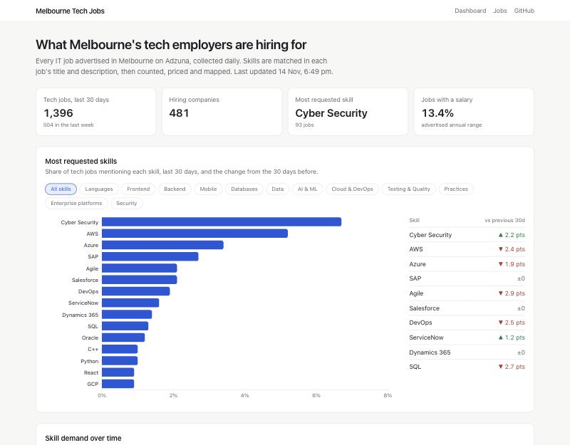

# Melbourne Tech Jobs

[](https://github.com/Nilish1994/melbourne-tech-jobs/actions/workflows/ci.yml)

**Which tech skills are Melbourne employers hiring for, what do they pay, and where are the jobs?**

This project collects every IT job advertised in Melbourne on [Adzuna](https://www.adzuna.com.au) each day, finds the skills
each one asks for, and turns that into a dashboard: the most requested skills and how their share is changing, weekly
trends, salary ranges per skill, and where the jobs are.

**Live demo:** https://jobs.imisstech.com.au (going live soon)


<sub>Real data, 14 Nov 2026: 2,445 Melbourne IT adverts collected, 1,396 listed in the last 30 days.</sub>

## How it works

```
Adzuna API ──► collector (daily, systemd) ──► PostgreSQL ──► FastAPI analytics ──► Next.js dashboard
                 │ quota ledger                  │ jobs           │ /analytics/*        │ server components
                 │ advisory lock                 │ job_skills     │ /jobs               │ + Recharts
                 └ ingestion_runs audit          └ runs           └─────────────────────┘ /api proxy (read-only)
```

| Part | Tech |
|---|---|
| Collector and API | Python 3.12, FastAPI, SQLAlchemy 2 (Core), Alembic, httpx |
| Database | PostgreSQL 16 |
| Dashboard | Next.js 15 (App Router), TypeScript, Tailwind CSS, Recharts |
| Ops | Docker Compose, systemd timer, nginx, GitHub Actions |

## Design decisions

- **The API quota is never exceeded.** Every HTTP attempt to Adzuna, retries included, is recorded in PostgreSQL before it
  is made. Rolling day, week and month windows are checked under an advisory lock, so parallel or overlapping runs can't
  overspend the free-tier limits.
- **Re-running is always safe.** Jobs are upserted on `(source, source_job_id)` with `ON CONFLICT`. Each page commits
  atomically with its run counters, and an interrupted run is recovered on the next start.
- **Incremental collection with an audit trail.** Every run is stored in `ingestion_runs`, with its pages, new and updated
  counts, and a sanitised error summary that never includes credentials or URLs. Only successful runs advance the
  incremental checkpoint, which is kept per location *and* category.
- **Deterministic skill extraction, no LLM.** A curated catalog of 107 skills with aliases (`k8s` → Kubernetes,
  `react.js` → React) is matched with token-boundary regexes. Words that are also everyday English ("react", "swift",
  "spring") only count in their capitalised product form. The results are reproducible, free to compute and unit-tested
  against false positives. Changing the catalog only needs `python -m app.cli.backfill_skills`.
- **Comparisons that mean something.** Skill trends use *share of jobs*, not raw counts, so a busy month doesn't make every
  skill look like it's growing. Salary medians use the midpoint of the advertised annual range. Hourly and daily rates
  (anything outside $30k–$500k) are left out so they don't skew the numbers.
- **Respecting the data source.** Following Adzuna's terms, the site links to each advert instead of republishing its
  description, and it shows "Jobs by Adzuna" attribution. Descriptions are only used for skill matching.
- **A small attack surface.** PostgreSQL sits on an internal Docker network. The API binds to localhost. The browser only
  ever reaches a read-only proxy route that allowlists `/analytics/*` and `/jobs`.

## Run it locally

Requires Docker.

```bash
cp .env.example .env            # set POSTGRES_PASSWORD; add ADZUNA_APP_ID / ADZUNA_APP_KEY for real data
docker compose up -d --build db api web
docker compose run --rm api alembic upgrade head
docker compose run --rm api python -m app.cli.seed_demo   # optional: synthetic demo jobs
open http://localhost:3020
```

To collect real data, get a free key from [developer.adzuna.com](https://developer.adzuna.com), then run:

```bash
docker compose run --rm api python -m app.cli.ingest --max-pages 5      # IT jobs in Melbourne
docker compose run --rm api python -m app.cli.ingest --incremental      # what the daily timer runs
```

`seed_demo` refuses to run on a database that holds real jobs, and `seed_demo --clear` removes only demo rows.

## Tests

```bash
docker compose --profile test run --rm tests
```

132 tests run against a real PostgreSQL. They cover the Adzuna client (retries, `Retry-After`, quota exhaustion,
sanitised errors), the collector (locking, recovery, checkpoints, categories), skill extraction (matches and
false positives), and every analytics endpoint against known data. CI also checks that migrations downgrade and
upgrade cleanly, lints and type-checks the dashboard, and builds it.

## API

| Endpoint | What it returns |
|---|---|
| `GET /analytics/summary?days=30` | job and company counts, salary coverage, top skill, last update |
| `GET /analytics/skills?days=30&group=` | top skills with share of jobs and change vs the previous period |
| `GET /analytics/skills/trend?skill=Python&skill=React&weeks=12` | weekly share per skill |
| `GET /analytics/salaries?days=90&min_jobs=5` | annual salary quartiles per skill |
| `GET /analytics/locations?days=30` | jobs by area |
| `GET /jobs?search=&skill=&location=&page=` | newest jobs with their skills (no descriptions) |

Interactive docs at `http://localhost:8020/docs`.

## Deployment

The production setup runs on a single Ubuntu VPS:
- `docker compose up -d` runs the stack.
- [`deploy/melbourne-tech-jobs-collector.timer`](deploy/melbourne-tech-jobs-collector.timer) runs incremental collection
  daily at 3am Melbourne time.
- nginx with Let's Encrypt proxies the domain to the web container ([example](deploy/nginx-jobs.conf)).

## Limitations

- Adzuna's API returns description *snippets*, so a skill mentioned only deep in a full advert can be missed. Counts are
  best read as relative demand.
- Adzuna aggregates many job boards, so the same role is occasionally listed twice under different IDs.

## License

MIT. Job data © its respective sources, provided by [Adzuna](https://www.adzuna.com.au).
